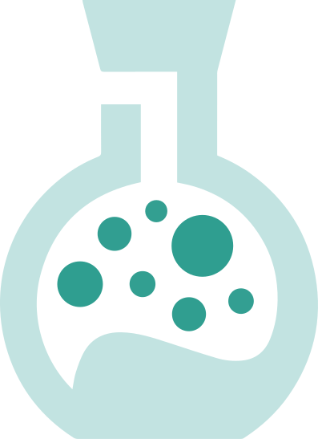

#  Sandbox Science

**Sandbox Science** is an interactive platform designed to make learning and exploring scientific concepts fun and accessible. The platform offers a variety of simulations, from cellular automata like Game of Life to complex particle interactions in Particle Life and Particle Brain, allowing users to dive deep into the fascinating world of science through hands-on, visual experiences.

---

## Particle Life

The classic particle simulator where simple interaction rules produce complex, emergent behaviors. Tweak forces and starting conditions to reveal stable clusters, flowing patterns, and chaotic transitions in real time.

- **CPU renderer** - fully compatible on every device
- **GPU (WebGPU) 2D renderer** - higher FPS, smoother motion, bigger particle counts
- **GPU (WebGPU) 3D renderer** - full 3D simulation with spatial binning

## Particle Brain

Particle Life extended with an emergent **Quantum / Electrical** layer. Only available in **2D GPU** mode.

On top of the usual matter colors, the engine spawns two extra particle types that act on the bodies in a more "quantum & electrical" way:

- **Urges** - goal-seeking particles that learn via Hebbian rules and recruit nearby neurons
- **Neurons** - per-color actuators driven by urge control signals (muscles, eyes, ears, nose)
- **Recurrent Brain Network** - GPU compute pass mapping urge errors to neuron modulations
- **Per-particle Evolvable Drives** - target/scale/gain parameters with GPU mutation for evolutionary dynamics
- **Magnetic (Lorentz) Forces** - per-species charge via golden-angle hash, spiral motion; muscle neurons steer matter via local Lorentz fields

> Experimental and tuned for play. Start with the defaults (60 urges / 60 neurons) and adjust *Urge Field Strength* and *Control Gain* to taste.

## Features

- **Game of Life**: Explore cellular automata and understand the basics of computational biology.
- **Particle Life**: Simulate and observe the behavior of particle systems with CPU, GPU 2D, and GPU 3D renderers.
- **Particle Brain**: Particle Life + urges, neurons, brain networks, evolvable drives, and magnetic forces.
- **Hash Life**: Optimized Game of Life using hash-based pattern matching.
- **More Simulations**: Dive into various scientific simulations, with more being added regularly.

## Goals

Sandbox Science aims to:

- Make complex scientific concepts easier to understand through visual and interactive experiences.
- Provide an open platform where science enthusiasts can explore, learn, and contribute.
- Encourage collaboration and community-driven development.

## Installation

To run Sandbox Science locally, follow these steps:

1. **Clone the repository:**
   ```bash
   git clone https://github.com/DicSo92/SandboxScience.git
   cd sandbox-science
   ```

2. **Install dependencies:**
   ```bash
   npm install
   ```

3. **Run the development server:**
   ```bash
   npm run dev
   ```

4. **Open your browser:**
   Visit http://localhost:3000 to explore the site locally.

## Build

To build the project for production, use the following command:

```bash
npm run build
```

This will create an optimized version of the project in the `.output` directory, ready for deployment.

## Testing

Run the test suite:

```bash
npm test
```

Tests cover color-space conversions, palette generators, rule-matrix generators, brain drive behavior, and WGSL stride consistency.

## Contributing

Sandbox Science is open-source and we welcome contributions from the community! Here's how you can get involved:

1. **Fork the repository**
2. **Create a new branch**
   ```bash
   git checkout -b feature/YourFeatureName
   ```
3. **Make your changes**
4. **Submit a pull request**

Please ensure your changes adhere to our [contribution guidelines](CONTRIBUTING.md) and respect the project's code of conduct.

## Community & Support

Join our [Discord community](https://discord.com/invite/z5yuzkFpCA) to share feedback, suggest new features, and engage with other science enthusiasts. Your insights and contributions help us improve Sandbox Science.

## License

Copyright (C) 2024-2026 Charly Luzzi (DicSo92)

This project is licensed under the [GNU Affero General Public License v3.0 (AGPL-3.0)](LICENSE). You can use, modify, and distribute the software, but modifications must also be shared under AGPL-3.0. See the [LICENSE](LICENSE) file for more details.

## Acknowledgments

- Thanks to everyone who has contributed to this project.
- Special thanks to the open-source community for their continuous support and inspiration.
